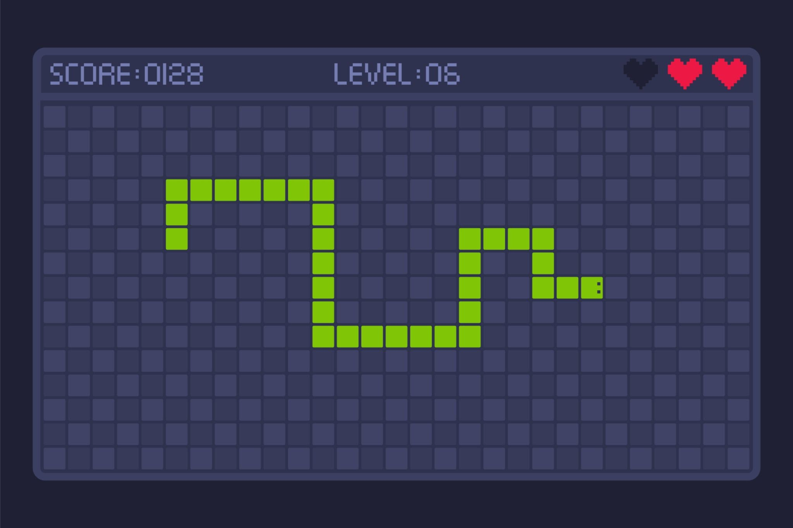

# How to create a snake game in python
## Install Pygame
Open your terminal or command prompt and install Pygame:
```bash
pip install pygame
```
## Create the Python Script
Save the following code into a file named snake.py:
```python
import pygame
import random
import sys

# Initialize Pygame
pygame.init()

# Game Constants
WIDTH, HEIGHT = 600, 400
GRID_SIZE = 20
FPS = 10

# Colors
BLACK = (0, 0, 0)
GREEN = (0, 255, 0)
RED = (255, 0, 0)
WHITE = (255, 255, 255)

# Setup Screen
screen = pygame.display.set_mode((WIDTH, HEIGHT))
pygame.display.set_caption("Python Snake Game")
clock = pygame.time.Clock()

def run_game():
    # Initial Snake position (3 segments) and direction
    snake = [[100, 100], [80, 100], [60, 100]]
    direction = "RIGHT"
    
    # Spawn initial food
    food = [random.randrange(0, WIDTH // GRID_SIZE) * GRID_SIZE,
            random.randrange(0, HEIGHT // GRID_SIZE) * GRID_SIZE]
    
    score = 0
    
    while True:
        for event in pygame.event.get():
            if event.type == pygame.QUIT:
                pygame.quit()
                sys.exit()
            elif event.type == pygame.KEYDOWN:
                if event.key == pygame.K_UP and direction != "DOWN":
                    direction = "UP"
                elif event.key == pygame.K_DOWN and direction != "UP":
                    direction = "DOWN"
                elif event.key == pygame.K_LEFT and direction != "RIGHT":
                    direction = "LEFT"
                elif event.key == pygame.K_RIGHT and direction != "LEFT":
                    direction = "RIGHT"

        # Calculate new head location
        head_x, head_y = snake[0]
        if direction == "UP": head_y -= GRID_SIZE
        elif direction == "DOWN": head_y += GRID_SIZE
        elif direction == "LEFT": head_x -= GRID_SIZE
        elif direction == "RIGHT": head_x += GRID_SIZE
        
        new_head = [head_x, head_y]

        # Check collision with walls
        if head_x < 0 or head_x >= WIDTH or head_y < 0 or head_y >= HEIGHT:
            break

        # Check collision with self
        if new_head in snake:
            break

        snake.insert(0, new_head)

        # Check food collision
        if new_head == food:
            score += 10
            food = [random.randrange(0, WIDTH // GRID_SIZE) * GRID_SIZE,
                    random.randrange(0, HEIGHT // GRID_SIZE) * GRID_SIZE]
        else:
            snake.pop()  # Remove tail segment if food wasn't eaten

        # Drawing
        screen.fill(BLACK)
        
        # Draw Snake
        for segment in snake:
            pygame.draw.rect(screen, GREEN, (*segment, GRID_SIZE, GRID_SIZE))
            
        # Draw Food
        pygame.draw.rect(screen, RED, (*food, GRID_SIZE, GRID_SIZE))

        # Display Score
        font = pygame.font.SysFont(None, 30)
        score_surface = font.render(f"Score: {score}", True, WHITE)
        screen.blit(score_surface, (10, 10))

        pygame.display.flip()
        clock.tick(FPS)

if __name__ == "__main__":
    run_game()
```

## Run the Game
Execute the script from your terminal:
```bash
python snake.py
```
